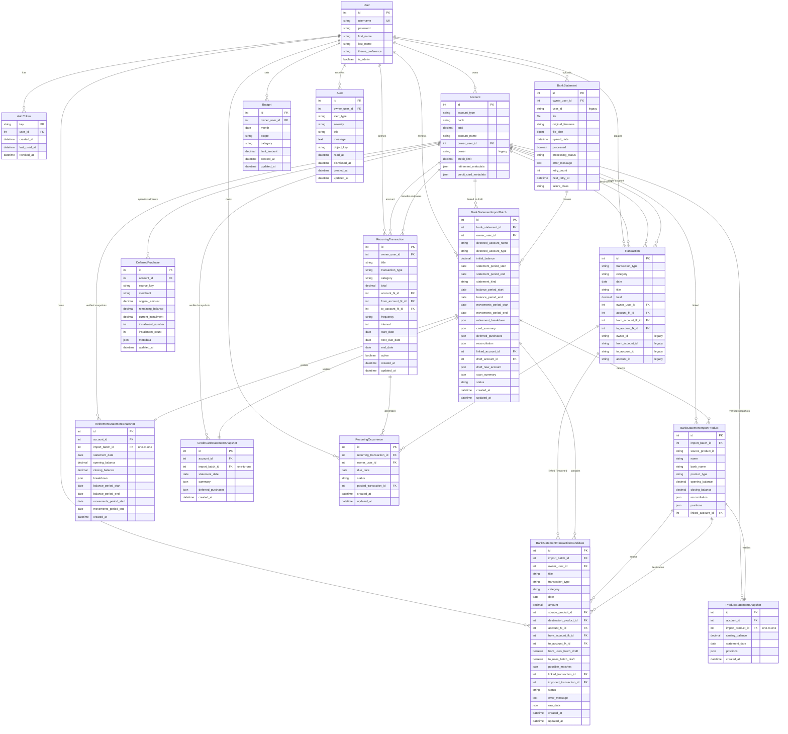
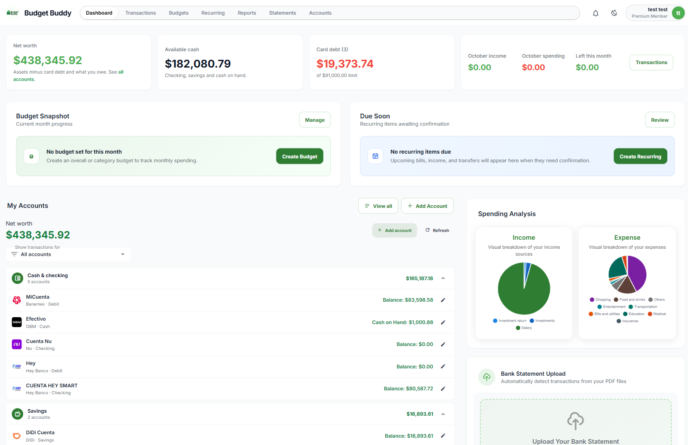
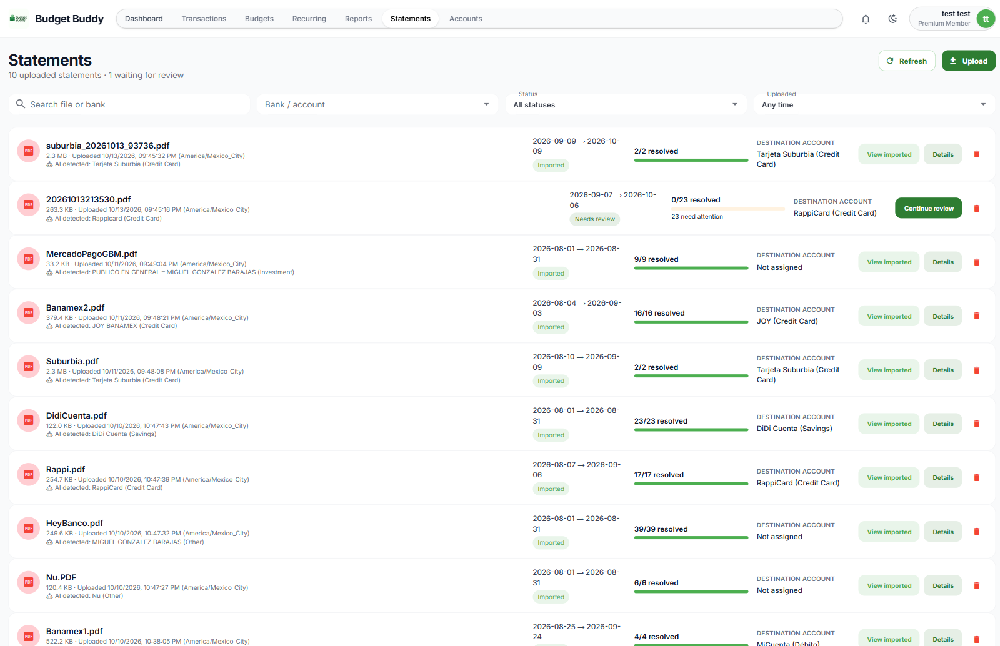
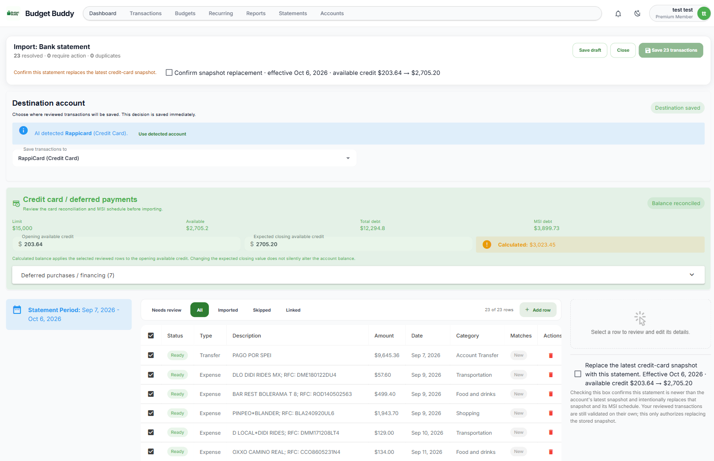
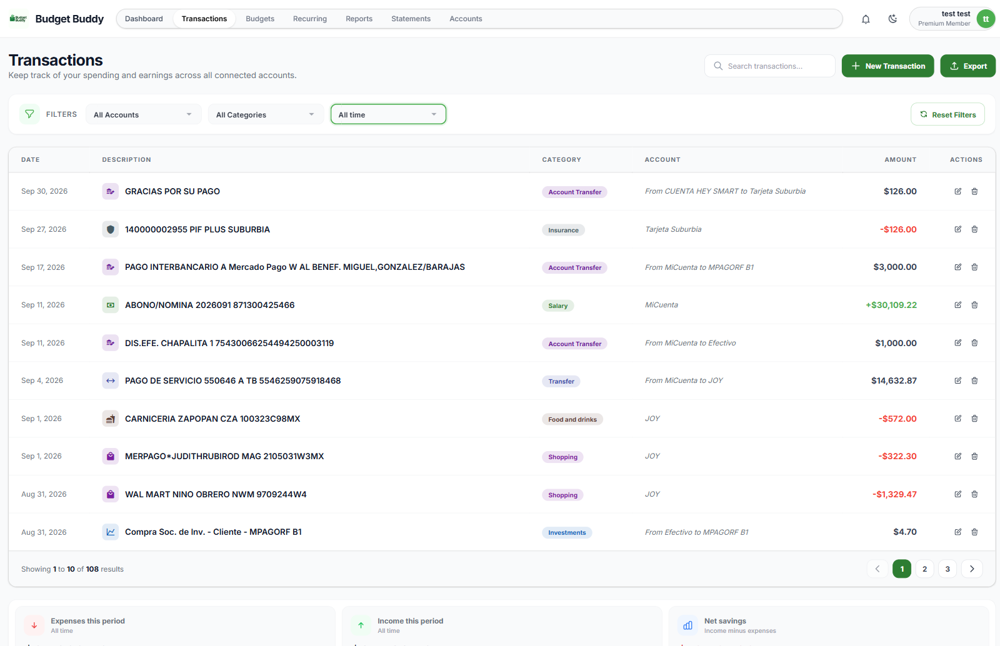
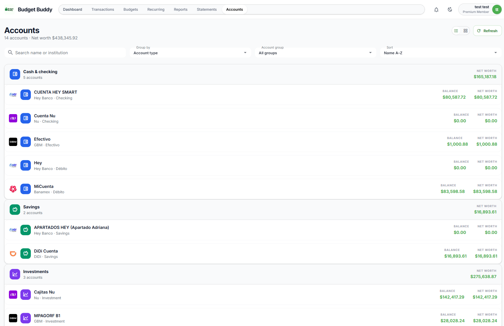
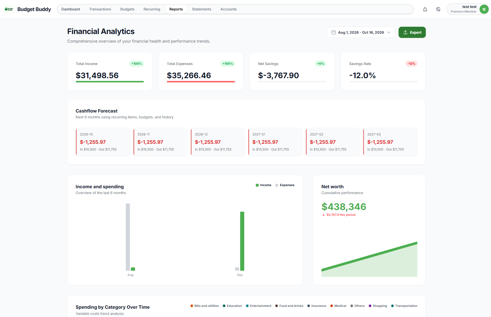

# Home Money Management - Budget Buddy

A comprehensive full-stack personal finance management application that helps users track expenses, manage multiple accounts, plan budgets, confirm recurring items, reconcile statement imports, and visualize financial data with forecasting and in-app alerts.

**Current release:** v1.1.1

### Release Highlights

- Phone-only authenticated layout fixes for Dashboard, Transactions, Budgets, Recurring, Reports, and Profile
- Compact phone navigation menu at widths below the existing `sm` breakpoint while preserving desktop navigation
- Mobile table scrolling for Transactions, Budgets, and Recurring without body-level horizontal overflow
- Transactions export control moved out of the phone header flow to prevent overlap
- v1.1.0 baseline: token-authenticated API admin mode, private OpenAPI/Swagger docs, hardened Docker exposure defaults, and owner-scoped finance workflows

## 🚀 Features

### 💰 Financial Management

- **Multi-Account Support**: Manage multiple bank accounts with different types (Checking, Savings, Credit Card, Cash, Investment, Retirement, Loan, Mortgage, and more)
- **Credit Card Management**: Track credit limits, available credit, and used credit with real-time calculations
- **Net Worth Calculation**: Automatic calculation of total net worth (assets minus liabilities)
- **Transaction Tracking**: Record and categorize income and expenses
- **First-Class Transfers**: Move money between accounts with required source/destination accounts; transfers are excluded from income/expense totals
- **Monthly Budgets**: Track overall monthly budgets and category-specific budgets with spent, remaining, percent-used, and status calculations
- **Recurring Transactions**: Define income, expense, and transfer rules that generate due items for user confirmation before posting real transactions
- **Real-time Balance Updates**: Automatic balance calculations across all accounts
- **Date-based Filtering**: View transactions by month and year
- **AI-Powered Bank Statement Processing**: Upload PDF bank statements (including password-protected files) for automatic transaction extraction using Google AI Studio (Gemini API)
- **Initial Balance Detection**: Automatically detects and sets initial account balances from bank statements
- **Import Reconciliation**: Review parsed statement candidates, detect possible duplicates, import, skip, or link to existing transactions with idempotent commits

### 📊 Data Visualization

- **Interactive Charts**: Beautiful pie charts showing expense categories
- **Cashflow Forecasting**: Forecast future balances from current balances, confirmed transactions, recurring items, budgets, and trailing history
- **Financial Projections**: Smart forecasting based on historical data with seamless solid-to-dotted line transitions
- **Income vs Expense Analysis**: Visual comparison of financial flows
- **In-App Alerts**: Alert center for budget thresholds, recurring due/overdue items, forecasted negative balances, and import duplicate-review items
- **Accounts Overview**: Grouped account summaries with balances and net worth

### 🎨 Modern User Interface

- **Responsive Design**: Works seamlessly on desktop, tablet, and mobile
- **Material Design**: Built with Vuetify 3 for a modern, professional look
- **Dark/Light Theme Support**: Persisted user preference for `system`, `light`, or `dark`, with a quick header toggle
- **Intuitive Navigation**: Clean, user-friendly interface

### 🔐 Security & Authentication

- **User Registration & Login**: Secure authentication system
- **Token Authentication**: DRF-style opaque tokens sent with `Authorization: Token <token>`
- **Session Management**: The frontend stores only `{ token, user }` in localStorage and clears invalid/legacy sessions
- **Data Privacy**: Server-enforced user-specific data isolation
- **API Admin Mode**: Token users with `is_admin=True` can manage safe user fields and revoke active tokens through `/api-admin/`
- **Private API Documentation**: OpenAPI schema and Swagger UI are available at `/schema/` and `/docs/` when enabled

## 🏗️ Architecture

### Backend (Django REST API)

- **Framework**: Django 5.2.17 with Django REST Framework 3.17.2
- **Database**: PostgreSQL 15 in Docker, SQLite for lightweight local development
- **API Endpoints**: RESTful APIs for users, accounts, transactions, budgets, recurring transactions, bank statements, reports, and alerts
- **Background Worker**: A dedicated `money-management-worker` container drives the bank-statement processing queue
- **Admin Interface**: Django admin for data management

### Database Schema

The application uses formal ownership/account foreign keys for integrity while temporarily keeping legacy string fields populated for older API/UI compatibility:



**Key Relationships:**

- **User → Account / Transaction / BankStatement / Budget / RecurringTransaction / Alert**: Ownership is enforced through each model's `owner_user` foreign key
- **User → AuthToken**: One-to-many opaque API tokens with revocable sessions
- **Account → Transaction**: One-to-Many through `account_fk`, `from_account_fk`, and `to_account_fk`
- **Account → RecurringTransaction**: One-to-Many through the single-account and transfer endpoint foreign keys
- **Account → Statement snapshots**: Verified retirement, product, and credit-card snapshots plus open deferred purchases
- **BankStatement → BankStatementImportBatch**: One statement can produce review batches, each owning its detected products, candidates, and verified snapshots
- **RecurringTransaction → RecurringOccurrence**: A rule generates due occurrences that post into `Transaction`
- **Transaction Types**: Income, Expense, Transfer, External Deposit, and External Withdrawal

**Database Design Notes:**

- **Foreign-key Integrity**: Ownership and account references are enforced by database relationships and owner-scoped validation
- **Compatibility Fields**: Legacy strings (`owner`, `owner_id`, `from_account_id`, `to_account_id`, `account_id`, `user_id`) remain populated during this transition
- **Decimal Money**: Balances, credit limits, and transaction totals use fixed-precision decimal fields
- **Token Auth**: `users.AuthToken` provides opaque API tokens and supports logout/revocation
- **User Preferences**: `theme_preference` stores `system`, `light`, or `dark`, and `is_admin` gates the `/api-admin/` endpoints
- **Transaction Flexibility**: Transactions support five types:
  - **Income/Expense**: Uses `account_fk` for a single account
  - **Transfer**: Uses `from_account_fk` and `to_account_fk` for inter-account transfers
  - **External Deposit / External Withdrawal**: Cash movements whose other side is outside the tracked account set; intentionally excluded from income/spending analytics
- **Budgeting**: Monthly `overall` and `category` budgets are owner-scoped and summarized with calculated spend/remaining values
- **Recurring Rules**: Recurring rules generate due occurrences; no real transaction is created until the user posts an occurrence
- **Import Review**: A statement upload persists a review batch with detected products and transaction candidates; commits are idempotent and skip already-processed candidates
- **Statement Snapshots**: Verified retirement, product, and credit-card snapshots are immutable records tied to the review batch that produced them
- **Deferred Payments**: `DeferredPurchase` tracks the latest state of each MSI/installment plan per credit card
- **Alerts**: Alerts are in-app only and can be refreshed, marked read (`read_at`), or dismissed (`dismissed_at`)
- **Credit Card Support**: Accounts include `credit_limit` for available-credit tracking and `credit_card_metadata` for the latest verified statement facts
- **File Management**: `BankStatement` handles PDF uploads with processing status and automatic retry tracking (`retry_count`, `next_retry_at`, `failure_class`)
- **Data Isolation**: All user data is isolated by authenticated user, not by client-supplied usernames

**Supported Account Types:**

- **Checking / Savings**: Standard positive-balance bank accounts
- **Debit** (`Débito`): Debit and point-of-sale accounts
- **Credit Card**: Credit accounts with a limit, available credit, and deferred-payment (MSI) tracking
- **Cash** (`Efectivo`): Physical cash accounts
- **Investment / Retirement**: Investment and AFORE/retirement accounts with verified statement snapshots
- **Loan / Mortgage**: Liability accounts
- **Business / Other**: Remaining account types

Account types are declared once in `UI/home-money-management/src/constants/taxonomy.ts` and mirrored by the API's `normalize_account_type` helper, so the two layers cannot drift.

### Frontend (Vue.js 3)

- **Framework**: Vue.js 3 with TypeScript
- **UI Library**: Vuetify 3 (Material Design) plus Tailwind CSS 4 utility classes
- **Charts**: Chart.js with vue-chartjs for data visualization
- **Build Tool**: Vite for fast development and building

### Deployment

- **Containerization**: Docker and Docker Compose
- **Multi-container Setup**: Separate API, UI, PostgreSQL, and bank-statement worker containers
- **Development Ready**: Hot reload and development tools included

## 📁 Project Structure

```text
HomeMoneyManagement/
├── API/                          # Django REST backend
│   ├── users/                    # Users, tokens, preferences, and API admin
│   │   ├── models.py            # User and AuthToken models
│   │   ├── views.py             # Registration, login, profile, preferences
│   │   ├── urls.py              # User route definitions
│   │   ├── authentication.py    # Opaque token authentication
│   │   ├── permissions.py       # Owner and admin permission classes
│   │   ├── admin_api_views.py   # /api-admin/ endpoints
│   │   ├── admin_api_urls.py    # /api-admin/ routes
│   │   ├── serializers.py       # User/token serialization
│   │   ├── services.py          # User business logic
│   │   ├── management/commands/set_api_admin.py
│   │   └── migrations/          # Database migrations
│   ├── account/                  # Accounts and balances
│   │   ├── models.py            # Account model (credit limit, retirement/card metadata)
│   │   ├── views.py             # Account create/update/delete endpoints
│   │   ├── urls.py              # Account route definitions
│   │   ├── serializers.py       # Account serialization
│   │   └── migrations/
│   ├── transaction/              # Income, expense, transfer, and external cash movements
│   │   ├── models.py            # Transaction model and its type choices
│   │   ├── views.py             # Transaction CRUD endpoints
│   │   ├── urls.py              # Transaction route definitions
│   │   ├── services.py          # Atomic balance-effect application
│   │   ├── serializers.py
│   │   └── migrations/
│   ├── bankstatements/           # Statement upload, AI extraction, review, and commit
│   │   ├── models.py            # Statements, import batches/products, snapshots, candidates
│   │   ├── views.py             # Upload, retry, review, MSI, and commit endpoints
│   │   ├── urls.py              # Statement route definitions
│   │   ├── services.py          # Gemini extraction prompt and response parsing
│   │   ├── reconciliation.py    # Balance reconciliation helpers
│   │   ├── tasks.py             # Background processing helpers
│   │   ├── serializers.py
│   │   ├── management/commands/ # process_bank_statements, restore_deferred_purchases
│   │   └── migrations/
│   ├── budgets/                  # Monthly overall/category budgets
│   │   ├── models.py            # Budget model
│   │   ├── views.py             # Budget CRUD and summary endpoints
│   │   ├── urls.py              # Budget route definitions
│   │   └── migrations/
│   ├── recurring/                # Recurring rules and due occurrences
│   │   ├── models.py            # RecurringTransaction and RecurringOccurrence
│   │   ├── services.py          # Due generation/posting helpers
│   │   ├── views.py             # Recurring CRUD, due, post, and skip endpoints
│   │   ├── urls.py              # Recurring route definitions
│   │   └── migrations/
│   ├── alerts/                   # In-app alerts
│   │   ├── models.py            # Alert model
│   │   ├── services.py          # Alert refresh/generation helpers
│   │   ├── views.py             # Alert list/read/dismiss endpoints
│   │   ├── urls.py              # Alert route definitions
│   │   └── migrations/
│   ├── reports/                  # Analytics, insights, and forecasts
│   │   ├── views.py             # Reports API endpoints
│   │   ├── urls.py              # Reports route definitions
│   │   └── services.py          # Analytics and forecast calculations
│   ├── MoneyManagement/          # Django project configuration
│   │   ├── settings.py          # Main configuration
│   │   ├── urls.py              # Root URL routing
│   │   ├── wsgi.py              # WSGI configuration
│   │   ├── asgi.py              # ASGI configuration
│   │   ├── pagination.py        # Shared pagination classes
│   │   ├── schema.py            # OpenAPI token-auth extension
│   │   └── error_handlers.py    # Custom error handling
│   ├── requirements.txt          # Python dependencies
│   ├── Dockerfile               # Backend container config
│   ├── manage.py                # Django management entry point
│   ├── create_superuser.py      # Admin user creation script
│   ├── create_superuser_interactive.py  # Interactive admin creation
│   ├── create_test_user.py      # Test user creation script
│   ├── README.md                # API documentation
│   └── GOOGLE_AI_SETUP.md       # Google AI Studio setup guide
├── UI/                          # Vue.js Frontend
│   └── home-money-management/
│       ├── src/
│       │   ├── components/      # Shared components
│       │   │   ├── AppHeader.vue
│       │   │   ├── AppFooter.vue
│       │   │   ├── LoginRegister.vue
│       │   │   ├── MainPage.vue
│       │   │   ├── AccountSummary.vue
│       │   │   ├── BankStatementUpload.vue
│       │   │   ├── TableData.vue
│       │   │   ├── TransactionDialog.vue
│       │   │   ├── PieChart.vue
│       │   │   ├── Projections.vue
│       │   │   ├── AlertCenter.vue
│       │   │   ├── BankLogo.vue
│       │   │   └── ThemeToggle.vue
│       │   ├── views/           # Routed pages
│       │   │   ├── Home.vue
│       │   │   ├── Profile.vue
│       │   │   ├── Accounts.vue
│       │   │   ├── Transactions.vue (+ Transactions.script.ts)
│       │   │   ├── Budgets.vue
│       │   │   ├── Recurring.vue
│       │   │   ├── Reports.vue (+ Reports.script.ts)
│       │   │   ├── Statements.vue
│       │   │   ├── ImportReview.vue
│       │   │   ├── StatementScanResult.vue
│       │   │   ├── HelpCenter.vue
│       │   │   ├── PrivacyPolicy.vue
│       │   │   └── TermsOfService.vue
│       │   ├── constants/       # Canonical taxonomy and category styles
│       │   │   ├── taxonomy.ts
│       │   │   └── categoryStyles.ts
│       │   ├── services/        # API, session, theme, formatting, import tracking
│       │   ├── router/          # Vue Router configuration
│       │   │   └── index.ts
│       │   ├── plugins/         # Vuetify and other plugins
│       │   │   ├── index.ts
│       │   │   └── vuetify.ts
│       │   ├── styles/          # settings.scss (Vuetify) and tailwind.css
│       │   ├── types/           # TypeScript custom property types
│       │   ├── assets/          # Static assets (logo-192.png, logo.svg)
│       │   ├── App.vue          # Main app component
│       │   ├── main.ts          # Application entry point
│       │   ├── shims-vue.d.ts   # Vue type declarations
│       │   └── vite-env.d.ts    # Vite environment types
│       ├── public/              # Public assets (favicon.ico, favicon.png)
│       ├── scripts/             # check-build-budget.mjs, make-favicons.mjs
│       ├── index.html           # SPA entry document
│       ├── package.json         # Node.js dependencies
│       ├── package-lock.json    # Dependency lock file
│       ├── tsconfig.json        # TypeScript configuration
│       ├── tsconfig.node.json   # Node-side TypeScript configuration
│       ├── vite.config.ts       # Vite build configuration
│       ├── tailwind.config.js   # Tailwind CSS configuration
│       ├── postcss.config.js    # PostCSS configuration
│       ├── Dockerfile           # Frontend container config
│       ├── nginx.conf           # Production web server config
│       └── README.md            # Frontend documentation
├── docker/                      # Supporting container build files
│   └── postgres/Dockerfile      # PostgreSQL image with pg_stat_statements
├── docs/                        # Project documentation
│   ├── screenshots/             # README screenshots
│   └── ui-overhaul-plan.md      # UI overhaul plan
├── Utils/                       # Utility scripts and tools
│   ├── README.md               # Test data generation documentation
│   └── TestData/               # Test data generation scripts
│       ├── populate_test_data.py
│       ├── populate_quick_test_data.py
│       ├── create_docker_test_data.py
│       ├── populate_test_data.bat
│       └── populate_test_data.sh
├── docker-compose.yaml          # Multi-container orchestration
├── create_admin_user.sh         # Admin user creation script
├── security-check.sh            # Security validation script
├── ADMIN_SETUP.md               # Django admin setup guide
├── SECURITY.md                  # Security policies and fixes
├── POSTGRES_MIGRATION.md        # PostgreSQL migration guide
└── README.md                    # This file
```

## 🚀 Quick Start

### Prerequisites

- Docker and Docker Compose
- Git

### Installation & Setup

1. **Clone the repository**

   ```bash
   git clone <repository-url>
   cd HomeMoneyManagement
   ```

2. **Start the application**

   ```bash
   docker-compose up --build
   ```

3. **Access the application**
   - **Frontend**: <http://localhost:8080>
   - **Backend API**: <http://localhost:8000> from the host/SSH tunnel only
   - **Admin Interface**: <http://localhost:8000/admin> from the host/SSH tunnel only
   - **API Docs**: <http://localhost:8000/docs> from the host/SSH tunnel only

Docker publishes only the UI publicly by default. The API binds to `127.0.0.1:${API_HOST_PORT:-8000}`, and PostgreSQL is kept on the Docker network without a host port. Use an SSH tunnel such as `ssh -L 8000:127.0.0.1:8000 user@vm` for remote API, admin, or Swagger access.

### Default Admin Credentials

Docker development creates a default admin account if one does not already exist. Treat these as local-only credentials and override them for shared or production environments.

- **Username**: `admin`
- **Email**: `admin@example.com`
- **Password**: `admin123`

You can override these with `DJANGO_SUPERUSER_USERNAME`, `DJANGO_SUPERUSER_EMAIL`, and `DJANGO_SUPERUSER_PASSWORD`.

### Test Data Setup

For testing with realistic data, you can populate the database with sample data:

```bash
# Quick setup (2 accounts, 20 transactions)
cd Utils/TestData
python populate_quick_test_data.py

# Full setup (4 accounts, 100 transactions)
python populate_test_data.py

# Interactive menu (Windows)
populate_test_data.bat

# Interactive menu (Unix/Linux)
chmod +x populate_test_data.sh
./populate_test_data.sh
```

**Test User Credentials**:

- **Username**: `testUser`
- **Password**: `testpass123`

The utility seeders currently focus on accounts and transactions. Use the UI or API to create budgets, recurring rules, import review decisions, and alerts while testing those newer workflows.

## 🎯 Usage Guide

### Getting Started

1. **Register/Login**: Create a new account or login with existing credentials
2. **Add Accounts**: Create your first bank account with initial balance
3. **Record Transactions**: Start adding income and expense transactions
4. **View Analytics**: Explore your financial data through charts and projections

### Key Features

#### Account Management

- Create multiple accounts (Checking, Savings, Credit Card, Cash, Investment, Retirement, Loan, Mortgage, and more)
- Set initial balances and account details
- **Credit Card Features**:
  - Set and update credit limits
  - Track available credit and used credit
  - Real-time debt calculation (Credit Limit - Available Credit)
  - Deferred-payment (MSI) tracking from imported card statements
- View grouped account summaries with balances and net worth
- **Net Worth Tracking**: See your total net worth (assets minus liabilities) in the accounts overview

#### Transaction Tracking

- Add income, expense, transfer, and external cash-adjustment transactions manually
- Transfers require different source and destination accounts
- Credit-card payments are represented as transfers from the payment account to the credit-card account
- **AI-Powered Import**: Upload bank statement PDFs for automatic transaction extraction
- **Password-Protected PDF Support**: Upload encrypted PDF bank statements with password
- **Review Before Commit**: Statement uploads create import batches so users can import, skip, or link candidates to existing transactions
- **Duplicate Detection**: Import review surfaces possible matches by owner, account, date, amount, normalized title, and transaction type
- Categorize transactions for better organization
- Filter transactions by date, account, and type
- Edit and delete existing transactions
- **Automatic Account Creation**: Create new accounts directly from bank statements with detected initial balances

#### Budgets

- Create one overall monthly budget or multiple category budgets
- Track limit, spent amount, remaining amount, percent used, and status
- Dashboard widgets highlight current month progress and over-budget categories

#### Recurring Transactions

- Create recurring income, expense, and transfer rules
- Due items are generated from recurrence rules but require user confirmation before posting
- Skip due occurrences without creating a real transaction
- Dashboard and Recurring page show due/overdue items

#### Financial Analytics

- **Pie Charts**: Visual breakdown of expense categories
- **Income vs Expense**: Monthly comparison charts
- **Cashflow Forecasts**: Future cashflow based on balances, confirmed transactions, recurring items, budgets, and historical fallback averages
- **In-App Alerts**: Budget threshold, recurring due/overdue, negative-balance forecast, and import duplicate-review alerts
- **Account Balances**: Real-time balance tracking across all accounts

#### Projections Feature

- **Smart Forecasting**: Predicts future financial trends
- **Configurable Periods**: 3 months, 6 months, or 1 year projections
- **Account Filtering**: View projections for specific accounts or all accounts
- **Visual Distinction**: Solid lines for historical data, dotted lines for projections
- **Seamless Transitions**: Continuous lines that transition from solid to dotted at the appropriate point

## 🔧 Development

### Backend Development

```bash
# Navigate to API directory
cd API

# Install dependencies
pip install -r requirements.txt

# Run committed migrations
python manage.py migrate

# Create superuser
python create_superuser.py

# Start development server
python manage.py runserver
```

### Frontend Development

```bash
# Navigate to UI directory
cd UI/home-money-management

# Install dependencies
npm install

# Start development server
npm run dev

# Build for production
npm run build
```

The Vite development server runs on <http://localhost:3000> and proxies `/api` requests to the Django API. Docker serves the production frontend on <http://localhost:8080>.

### API Endpoints

Register and login return `{ valid, token, user }`. Authenticated requests must include:

```http
Authorization: Token <token>
```

Route usernames are retained for compatibility, but the server derives the effective owner from the token. Mismatched route usernames return `403`.

#### Users

- `POST /user/register/` - Create a user and issue a token
- `POST /user/login/` - Login and issue a token
- `POST /user/logout/` - Revoke the current token
- `GET /user/profile/` - Get the authenticated user's profile
- `PUT /user/update-info/` - Update the authenticated user's username/name
- `PUT /user/change-password/` - Change the authenticated user's password
- `GET /user/preferences/` - Get persisted user preferences
- `PUT /user/preferences/` - Update `theme_preference`
- `GET /user/detail/<username>/` - Get details for the authenticated user
- `DELETE /user/detail/<username>/` - Delete the authenticated user after password confirmation

#### API Admin

- `GET /api-admin/users/` - List API users without passwords or token values; requires `is_admin=True`
- `PATCH /api-admin/users/<id>/` - Update safe user fields including `first_name`, `last_name`, `theme_preference`, and `is_admin`
- `POST /api-admin/users/<id>/tokens/revoke/` - Revoke all active API tokens for a user

Promote or demote API admins from the backend directory:

```bash
python manage.py set_api_admin <username> --enabled true
python manage.py set_api_admin <username> --enabled false
```

#### OpenAPI Docs

- `GET /schema/` - OpenAPI schema when `API_DOCS_ENABLED=True`
- `GET /docs/` - Swagger UI when `API_DOCS_ENABLED=True`

#### Accounts

- `POST /accounts/` - Create a new account for the token user
- `GET /accounts/details/<username>/<id>/` - List accounts for the token user (`id` is ignored for compatibility)
- `PATCH /accounts/details/<username>/<id>/` - Update one owned account
- `DELETE /accounts/delete/<username>/<id>/` - Delete one owned account

#### Transactions

- `POST /transactions/create/` - Create a transaction and apply the balance effect atomically
- `GET /transactions/retrieve/<username>/<account_id>/<month>/<year>/` - Get owned transactions; use `0` as a wildcard
- `PATCH /transactions/update/<transaction_id>/` - Reverse old balance effect, apply new effect, and save
- `DELETE /transactions/delete/<transaction_id>/` - Reverse balance effect and delete

#### Budgets

- `GET /budgets/?month=YYYY-MM` - List monthly budgets for the token user
- `POST /budgets/` - Create a monthly `overall` or `category` budget
- `GET /budgets/<id>/` - Retrieve one owned budget
- `PATCH /budgets/<id>/` - Update one owned budget
- `DELETE /budgets/<id>/` - Delete one owned budget
- `GET /budgets/summary/?month=YYYY-MM` - Return budget summary with calculated spend, remaining, percent used, and status

#### Recurring Transactions

- `GET /recurring-transactions/` - List recurring rules
- `POST /recurring-transactions/` - Create a recurring rule
- `GET /recurring-transactions/<id>/` - Retrieve one owned recurring rule
- `PATCH /recurring-transactions/<id>/` - Update one owned recurring rule
- `DELETE /recurring-transactions/<id>/` - Delete one owned recurring rule
- `GET /recurring-transactions/due/?through=YYYY-MM-DD` - Generate/list due occurrences through a date
- `POST /recurring-transactions/due/<occurrence_id>/post/` - Post a due occurrence as a real transaction
- `POST /recurring-transactions/due/<occurrence_id>/skip/` - Skip a due occurrence

#### Bank Statements

- `POST /bank-statements/upload/` - Upload and process a bank statement PDF for the token user
- `GET /bank-statements/user/<user_id>/` - Get owned bank statements
- `GET /bank-statements/details/<statement_id>/` - Get owned bank statement details
- `POST /bank-statements/retry/<statement_id>/` - Retry a failed statement's AI processing
- `DELETE /bank-statements/delete/<statement_id>/` - Delete an owned bank statement
- `GET /bank-statements/import-batches/<id>/` - Retrieve a persisted import review batch
- `PATCH /bank-statements/import-batches/<id>/assignment/` - Set the batch destination (existing account or a new draft account)
- `PATCH /bank-statements/import-products/<id>/` - Link or relabel one detected statement product
- `POST /bank-statements/import-batches/<id>/candidates/` - Add a manual candidate to a review batch
- `PATCH /bank-statements/import-batches/<id>/msi/` - Update deferred-payment (MSI) details for the batch
- `PATCH /bank-statements/import-candidates/<id>/` - Mark a candidate for import, skip, or link
- `POST /bank-statements/import-batches/<id>/commit/` - Idempotently commit pending import decisions

#### Reports

- `GET /reports/analytics/<username>/` - Get financial KPIs, chart data, top categories, net worth, and smart insights
- `GET /reports/insights/<username>/` - Get smart insights for a date range
- `GET /reports/forecast/<username>/?months=6` - Get a cashflow forecast, capped at 12 months

#### Alerts

- `GET /alerts/` - List in-app alerts
- `POST /alerts/refresh/` - Regenerate v1 alerts for the authenticated user
- `PATCH /alerts/<id>/read/` - Mark an alert read
- `PATCH /alerts/<id>/dismiss/` - Dismiss an alert

## 🐳 Docker Deployment

### Local Docker

```bash
# Build and start containers
docker-compose up --build -d

# View logs
docker-compose logs -f

# Stop containers
docker-compose down
```

The API container runs committed migrations on startup. It does not generate migrations automatically.

### Security And Vulnerability Checks

Runtime images and dependency manifests should be checked before release or broad testing:

```bash
# Build images
docker compose build

# UI dependency audit; high/critical should pass
docker run --rm -v "${PWD}:/repo" -w /repo/UI/home-money-management node:lts-alpine3.23 npm audit --audit-level=high

# Trivy image scans can be run against exported image tarballs or local images.
# Current high/critical baseline after the hardening pass: 0 for UI, API, Postgres,
# UI package-lock, and API requirements.txt.
```

The Docker stack uses Alpine 3.23-based runtime images. The UI lockfile was hardened by updating `axios`, `immutable`, `picomatch`, and `rollup`, and by removing unused Vue CLI-era dev dependencies.

### Production Deployment

For production, provide explicit environment values and serve Django with Gunicorn:

```bash
export DEBUG=False
export SECRET_KEY=<strong-secret>
export ALLOWED_HOSTS=example.com
export CORS_ALLOWED_ORIGINS=https://example.com
export CORS_ALLOW_ALL_ORIGINS=False
export GOOGLE_AI_API_KEY=<google-ai-studio-key>
export GOOGLE_AI_MODEL=gemini-3.8-flash
export SECURE_SSL_REDIRECT=True
export SESSION_COOKIE_SECURE=True
export CSRF_COOKIE_SECURE=True
export SECURE_HSTS_SECONDS=31536000
# Set only after confirming the production domain and subdomains are preload-ready.
export SECURE_HSTS_PRELOAD=False

docker-compose up --build -d
```

The production API command should be:

```bash
python /HomeMoneyManagement/manage.py migrate
gunicorn --bind 0.0.0.0:8000 --workers=4 MoneyManagement.wsgi:application
```

`DEBUG=False` fails fast when `SECRET_KEY`, `ALLOWED_HOSTS`, or CORS origins are unsafe or missing. It also defaults SSL redirect, secure cookies, and HSTS to production-safe values.

### Environment Configuration

- Backend listens on container port 8000 and publishes to `127.0.0.1:${API_HOST_PORT:-8000}`
- Frontend publishes `${UI_HOST_PORT:-8080}:80`
- Database: PostgreSQL 15 in Docker, with a named `postgres_data` volume and no host port by default
- Admin interface available at `/admin` through the private API binding
- Swagger UI available at `/docs` when `API_DOCS_ENABLED=True`

## 📊 Technology Stack

### Backend

- **Django 5.2.17**: Web framework
- **Django REST Framework 3.17.2**: API framework
- **PostgreSQL 15 / SQLite**: PostgreSQL for Docker, SQLite for local development
- **Python 3.12**: Runtime environment (per the API Docker image)

### Frontend

- **Vue.js 3**: Progressive JavaScript framework
- **TypeScript**: Type-safe JavaScript
- **Vuetify 3**: Material Design component framework
- **Tailwind CSS 4**: Utility-first styling
- **Chart.js**: Data visualization library
- **Vite**: Build tool and development server
- **Vue Router**: Client-side routing

### DevOps

- **Docker**: Containerization
- **Docker Compose**: Multi-container orchestration
- **Nginx**: Web server (production frontend)
- **Trivy**: Container and dependency vulnerability scanning

## 🔒 Security Features

- **User Authentication**: Secure login system
- **Data Isolation**: User-specific data access
- **Input Validation**: Server-side validation for all inputs
- **SQL Injection Protection**: Django ORM protection
- **XSS Protection**: Built-in Django security features
- **Dependency Hardening**: npm and Python dependencies are scanned for high/critical issues before test/release passes

## 📈 Performance Features

- **Responsive Design**: Optimized for all screen sizes
- **Lazy Loading**: Efficient component loading
- **Chart Optimization**: Smooth animations and interactions
- **Database Indexing**: Optimized queries
- **Container Optimization**: Efficient Docker images

## 🤝 Contributing

1. Fork the repository
2. Create a feature branch (`git checkout -b feature/amazing-feature`)
3. Commit your changes (`git commit -m 'Add some amazing feature'`)
4. Push to the branch (`git push origin feature/amazing-feature`)
5. Open a Pull Request

## 📝 License

This project is licensed under the MIT License.

## 📚 Documentation

### Core Documentation

- **[API/README.md](API/README.md)** - Complete API documentation with endpoints and examples
- **[ADMIN_SETUP.md](ADMIN_SETUP.md)** - Django admin interface setup and usage guide
- **[SECURITY.md](SECURITY.md)** - Security policies, vulnerability management, and recent security fixes
- **[POSTGRES_MIGRATION.md](POSTGRES_MIGRATION.md)** - PostgreSQL migration guide for Docker deployment
- **[API/GOOGLE_AI_SETUP.md](API/GOOGLE_AI_SETUP.md)** - Google AI Studio (Gemini API) integration setup

### Quick Reference

- **API Endpoints**: See [API/README.md](API/README.md) for complete endpoint documentation
- **Admin Access**: See [ADMIN_SETUP.md](ADMIN_SETUP.md) for admin interface setup
- **Security Updates**: See [SECURITY.md](SECURITY.md) for latest security fixes and policies
- **Database Setup**: See [POSTGRES_MIGRATION.md](POSTGRES_MIGRATION.md) for PostgreSQL configuration
- **AI Integration**: See [API/GOOGLE_AI_SETUP.md](API/GOOGLE_AI_SETUP.md) for bank statement processing setup
- **Test Data Setup**: See [Utils/README.md](Utils/README.md) for test data generation scripts

## 🔒 Security

For security-related information:

- Review [SECURITY.md](SECURITY.md) for security policies and vulnerability management
- Check the [ADMIN_SETUP.md](ADMIN_SETUP.md) for admin interface setup
- Report security issues responsibly through GitHub security advisories

## 🆘 Support

For support and questions:

- Check the [ADMIN_SETUP.md](ADMIN_SETUP.md) for admin interface setup
- Review the API documentation in [API/README.md](API/README.md)
- Open an issue on GitHub

## 📸 Screenshots

<table>
  <tr>
    <td width="50%">
      <strong>Dashboard Overview</strong><br />
      
    </td>
    <td width="50%">
      <strong>Statement Upload &amp; Review Queue</strong><br />
      
    </td>
  </tr>
  <tr>
    <td width="50%">
      <strong>Statement Import Review</strong><br />
      
    </td>
    <td width="50%">
      <strong>Transactions Ledger</strong><br />
      
    </td>
  </tr>
  <tr>
    <td width="50%">
      <strong>Accounts Overview</strong><br />
      
    </td>
    <td width="50%">
      <strong>Financial Reports</strong><br />
      
    </td>
  </tr>
</table>

---

## 🎉 Acknowledgments

- Built with Vue.js and Django
- UI components by Vuetify
- Charts powered by Chart.js
- Icons by Material Design Icons
- AI-powered transaction extraction by Google AI Studio (Gemini API)

---

**Budget Buddy** - Your smart companion for financial management! 💰📊
